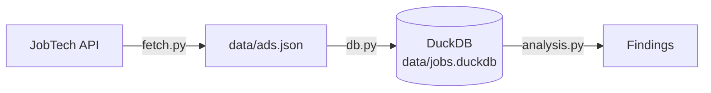

# sweden-jobs
**Live dashboard:** [sweden-jobs.streamlit.app](https://sweden-jobs.streamlit.app/)

A data pipeline that collects IT job ads in Sweden from the Swedish Public Employment Service's [JobTech API](https://jobtechdev.se/en/components/jobsearch) and analyses what the market asks for: language, skills, locations and entry-level opportunities.

## Why

When I moved to Italy to study, Sweden was not part of my plan; I was thinking about other countries. Through friendships I made here, I became interested in Sweden, and my university turned out to offer ways to do my master's at good Swedish universities. The more I looked at the country, the more I liked its culture. Take fika: it happens everywhere, at school, at work, around anything, and if you turn one down, people look at you like you've committed a crime.

So I started this project with one question: *as a first-year student, could I find a job in Sweden?* I partly found the answer. I was surprised that 73% of IT ads are written in Swedish; I expected far more English. It didn't change my decision, though: I still want an internship in Sweden next summer, and I believe I can get one.

## Key findings

Snapshot of 2,100 Data/IT ads on Platsbanken, collected on 2 November 2026.

**Language**
- **73%** of ads are written in Swedish, 27% in English.
- 29% of the English ads still mention Swedish ("svenska" or "Swedish").
- That leaves **about 19% of all ads** (≈400) written in English without mentioning Swedish: roughly one in five ads looks open to someone who doesn't speak Swedish. This is an upper bound, since some English ads expect Swedish without saying so.

**Skills** (share of ads mentioning each)

| Skill | Ads | Share |
|---|---|---|
| Python | 375 | 17.9% |
| Azure | 361 | 17.2% |
| SQL | 297 | 14.1% |
| Linux | 280 | 13.3% |
| Kubernetes | 224 | 10.7% |
| Java | 220 | 10.5% |
| AWS | 172 | 8.2% |

Azure is mentioned **twice as often as AWS**: the Swedish market leans on Microsoft. The shares look low because "Data/IT" is a broad field that also covers support, operations and testing roles.

**Locations:** Stockholm has 31% of the ads, Göteborg 16% and Linköping 7%.

**Entry level:** only **55 ads (2.6%)** are entry level by their headline, and 47 of those are junior or graduate roles. No summer jobs are posted yet; in Sweden they are usually published between January and March.

## How it works



- **`fetch.py`** pages through the API's Data/IT ads, newest first, with retries and back-off. It removes duplicate ads (ads can shift between pages during a crawl) and writes the result atomically, so a crash never leaves a half-written file.
- **`db.py`** upserts the ads into DuckDB. Nothing is deleted, so ads accumulate across runs and expired ads stay available for trend analysis.
- **`analysis.py`** detects each ad's language, checks for Swedish requirements, and counts skills, cities and entry-level ads.

## Limitations

- **API cap:** the search API stops answering after offset 2000, so one run collects at most 2,100 ads (out of 2,501 on 2 November). Because ads are sorted newest first, the oldest ads are the ones missed. Running daily and accumulating closes most of the gap.
- **`experience_required` is unreliable:** it says "experience required" even for most junior and graduate ads, including every Volvo Group Graduate Program ad. Entry-level ads are therefore detected from the headline instead.
- **Language detection is word-based:** it compares common Swedish and English words, so ads that mix both languages are labelled by whichever part is longer. "Swedish" can also mean "a Swedish company", which slightly inflates the Swedish-requirement count for English ads.
- **Platsbanken is not the whole market:** many large companies post graduate programmes and internships only on their own career sites or LinkedIn, so entry-level opportunities are likely undercounted.
- **Source texts:** a few ads are cut off in the source itself. The search API does not shorten texts (checked against the full ads from `/ad/{id}`), but incomplete ads can lower the shares slightly.

## How to run

Requires [uv](https://docs.astral.sh/uv/).

```bash
git clone https://github.com/Daggerabuse/sweden-jobs.git
cd sweden-jobs
uv sync

uv run python -m sweden_jobs.fetch      # download ads to data/ads.json
uv run python -m sweden_jobs.db         # load them into data/jobs.duckdb
uv run python -m sweden_jobs.analysis   # print the findings
```

## Roadmap

- **Automation:** a daily GitHub Actions run, a `last_seen` date per ad to separate open and closed ads, and tests.
- **Beyond the 2,000 cap:** split queries by publication date to collect every ad.
- **NLP:** better language detection, skill extraction beyond keyword lists, and clustering ads to see how many different jobs hide behind one title.